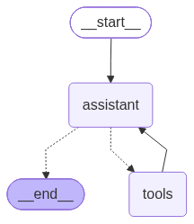

# Online Bookstore with Agentic RAG Chatbot

A full-stack online bookstore application that allows users to browse, purchase, and read e-books, while providing moderators with tools to manage books, user accounts, and payment transactions.

The application also integrates an Agentic Retrieval-Augmented Generation (RAG) chatbot enabling users to discover books, receive recommendations, and ask questions about book content using natural language.

## Features

### Public (no login required)
- Browse and search the e-book catalogue.
- View book details such as author, category, and price.
- Register for an account.
- Interact with the AI chatbot to discover books, get recommendations, and ask questions about book content.

### Users
- **Registration and approval:** register with a unique username, password, and personal details. The account can only log in after an administrator approves it.
- **Purchasing:** buy e-books using either:
  - **Cash account balance:** the payment succeeds only if the balance is sufficient.
  - **Cheque:** the payment is confirmed only after an administrator validates and approves the cheque.
- **Virtual bookshelf:** purchased e-books appear on the user's shelf and can be read online (PDF).
- **Records:** search and view book purchase contracts, cheque payment history, and cash transaction history.

### Administrators
- **E-book management:** search, view, add, and modify e-books. Details such as author, category, and price are set before a book is listed.
- **Account management:** approve account registration requests and reset user passwords.
- **Cheque payment management:** search, view, and modify cheque payments, and approve or reject them as part of the payment process.


## Agentic RAG Workflow



## Tech Stack

| Layer | Technology |
|---|---|
| Frontend | React.js |
| Backend | Spring Boot |
| Database | H2 (in-memory, for development) |
| Chatbot | FastAPI, LangChain, LangGraph |
| Vector store | Pinecone |

## Project Structure

```
.
├── demo/          # Spring Boot backend (bookstore API)
├── frontend/      # Web frontend
└── rag-backend/   # FastAPI service for the RAG chatbot
```

## Getting Started

### 1. Run the Spring Boot Backend

```
cd demo
.\mvnw.cmd spring-boot:run
```

The API runs at `http://localhost:8080`.

### 2. Run the Frontend

```
cd frontend
npm install
npm run dev
```

The app runs at `http://localhost:5173`.

### 3. Run the RAG Chatbot Backend

The bookstore works without this service. Only the AI assistant depends on it.

```
cd rag-backend
python -m venv venv
venv\Scripts\activate
pip install -r requirements.txt
```

Create a `.env` file:

```
PINECONE_API_KEY=your_pinecone_api_key
PINECONE_INDEX_NAME=your_index_name

# Credentials for your selected LLM provider
LLM_API_KEY=your_llm_api_key
```

Start the server:

```
uvicorn main:app --reload
```

The RAG service runs at `http://127.0.0.1:8000`.

## Future Improvements

- **Proper authentication and authorization:** adopt Spring Security (for example with JWT or session-based auth) instead of storing the user's role and username in `localStorage`, so roles are enforced on the server rather than trusted from the client. Passwords should also be hashed (for example with BCrypt) rather than stored in plain form.
- **Advanced book search:** currently books can only be searched by title. Add filters for author, category, and price range, with the option to combine them.
- **Production-ready database:** replace the in-memory H2 database with a persistent one such as MySQL or PostgreSQL.
- **Pagination and sorting:** paginate the book catalogue, purchase history and payment records and allow sorting by fields such as title, price and date.